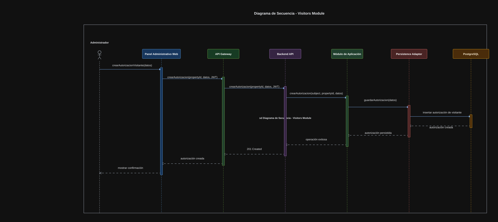

# Diagramas de arquitectura de MyComplex

Este documento reúne los diagramas actualizados del archivo de arquitectura de MyComplex. Cada imagen puede abrirse para consultarla en su tamaño completo.

## Diagrama de paquetes del backend

Organización del backend como monolito modular, incluyendo la arquitectura hexagonal interna de los módulos.

## Diagrama de componentes

Diagrama de componentes corregido. Se muestran los componentes propios, frameworks, plataforma, módulos del monolito modular, adaptadores, interfaces y las librerías/SDKs utilizadas para integrar tecnologías externas.

## Diagramas de secuencia por módulo

Los diagramas de secuencia se separan por módulo para representar interacciones concretas en el tiempo, conservando lifelines, mensajes, retornos y barras de activación.

### Acceso y autorización

### Users Module

### Properties Module

### Visitors Module

### News Module

### Tasks Module

### Meetings Module

### Notifications Module

### Audit Module

## Diagrama de paquetes del API Gateway

Paquetes, clases y dependencias principales de la implementación del API Gateway.

## Archivo editable

[Abrir el archivo actualizado de Draw.io](./MyComplex_Diagrama_Componentes_CORREGIDO.drawio)
