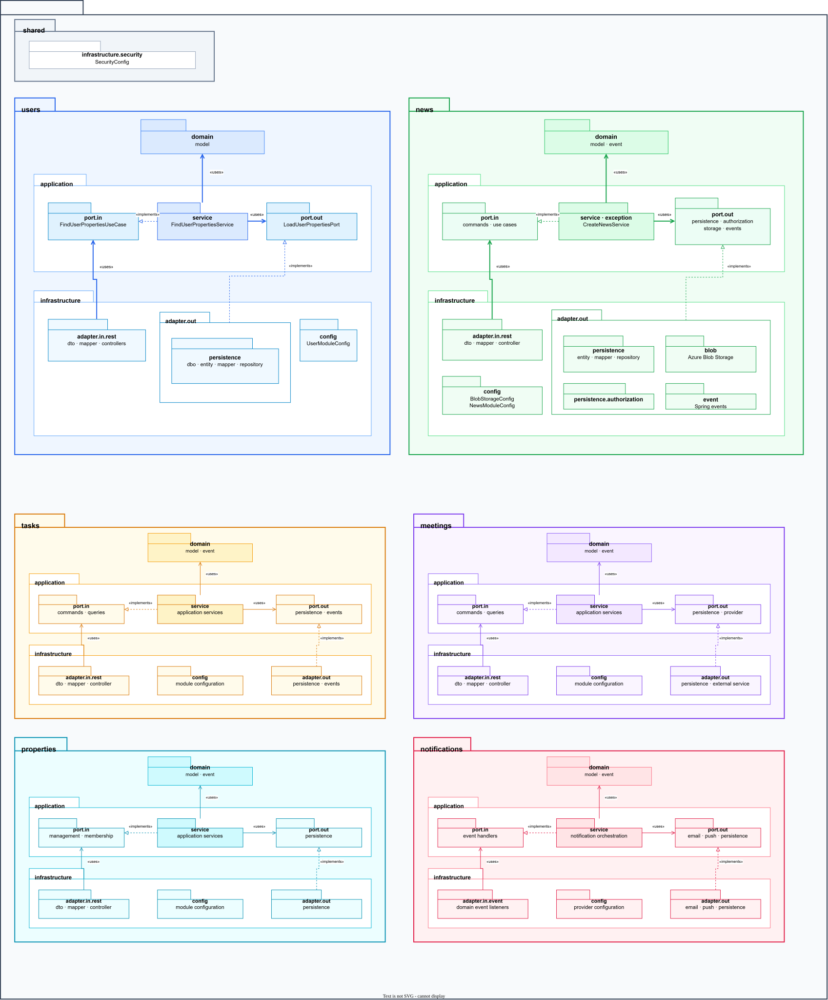
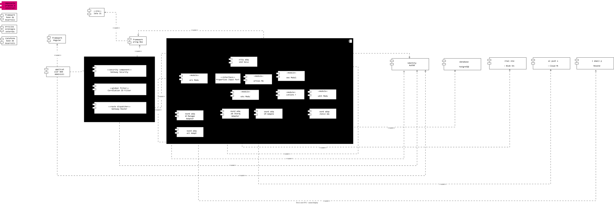
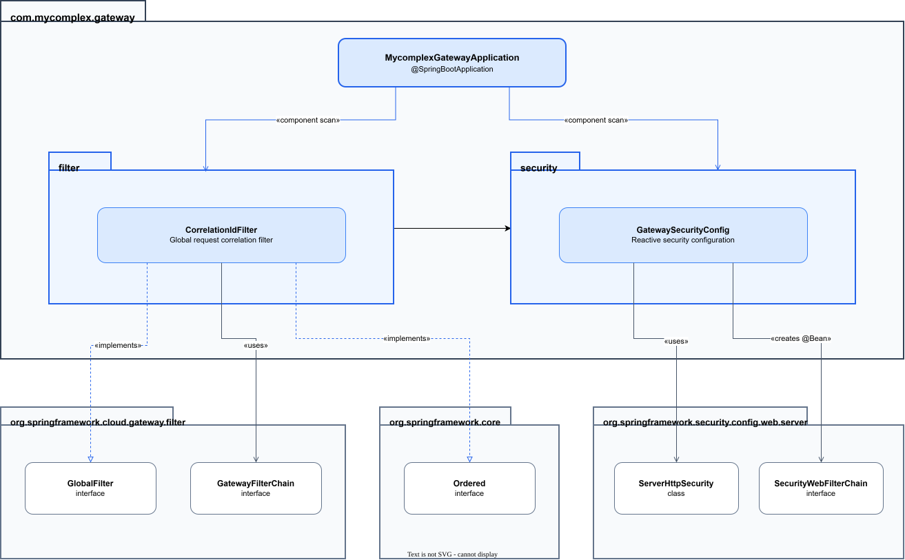

# Diagramas de arquitectura de MyComplex

Este documento reúne las páginas del archivo de arquitectura de MyComplex. Cada imagen puede abrirse para consultarla en su tamaño completo.

## Diagrama de paquetes del backend

Organización del backend como monolito modular, incluyendo la arquitectura hexagonal interna de los módulos.

## Diagrama de componentes

Componentes principales de MyComplex y sus relaciones: aplicación web, API Gateway, backend modular, adaptadores y servicios externos.

## Diagrama de secuencia

Interacciones y orden de comunicación entre los participantes del sistema para los flujos documentados.

## Diagrama de paquetes del API Gateway

Paquetes, clases y dependencias principales de la implementación del API Gateway.

## Archivo editable

[Abrir el archivo original de Draw.io](./Diagrama_de_paquetes.drawio)
