    # Diagramas de arquitectura de MyComplex

Este documento reúne las vistas de contexto, contenedores, componentes, paquetes y secuencias de MyComplex. Cada imagen puede abrirse en tamaño completo y se enlaza el archivo editable cuando está disponible en el repositorio.

## C4 Nivel 1 Contexto del sistema MyComplex

El modelo existente presenta My_Complex como un único sistema para gestionar vigilancia, reservas y comunicación en copropiedades. Relaciona al vigilante, administrador, propietario, residente y trabajador con el sistema, y muestra dependencias externas para datos, seguridad, notificaciones push y correo electrónico.

<a href="./Diagrams/c4-level-1-context.svg">
  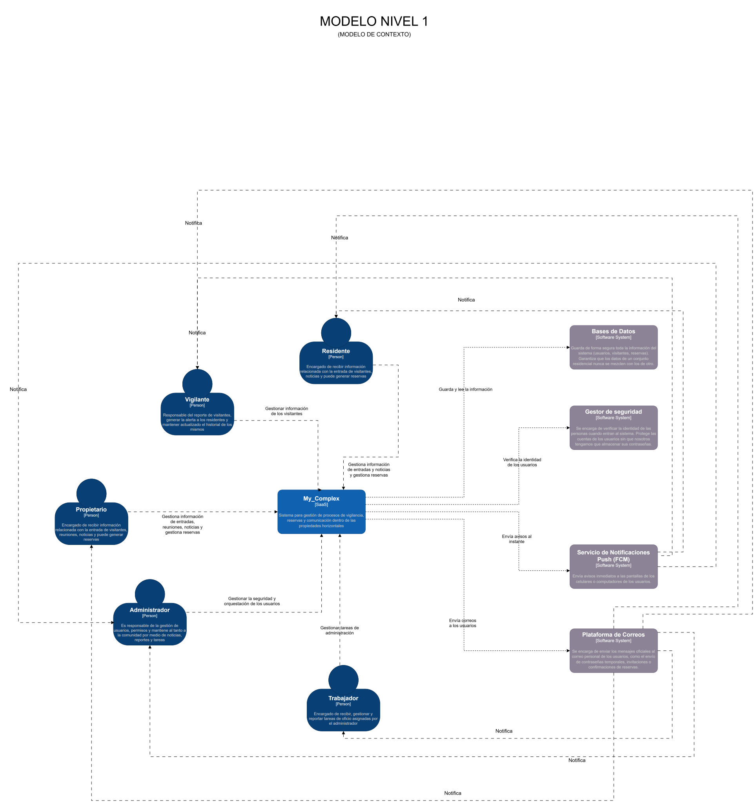
</a>

[Abrir el SVG en tamaño completo](./Diagrams/c4-level-1-context.svg) · [Editar el diagrama original en Draw.io](./C4_Nivel1.drawio)

## C4 Nivel 2 Contenedores de MyComplex

El modelo existente amplía My_Complex con su contenido frontend, API Gateway, Backend API, base de datos relacional y almacenamiento de imágenes. También presenta Auth0, Firebase, Resend, Wompi, Key Vault, monitoreo, los perfiles de usuario y sus relaciones principales mediante HTTPS, REST/JSON y TCP/IP.

El diagrama original incluye IndexedDB para operación offline y un WAF. Ambos representan arquitectura objetivo según ADR-0002 y ADR-0012 y no deben interpretarse como implementación actual.

[Abrir el SVG en tamaño completo](./Diagrams/c4-level-2-containers.svg) · [Editar el diagrama original en Draw.io](./C4_Nivel2.drawio)

## Diagrama de componentes

Este diagrama organiza la solución por componentes propios, frameworks, librerías de integración y plataforma. Permite reconocer Angular, el API Gateway, el backend modular, los adaptadores de Auth0, Blob Storage, Firebase y Resend, y la persistencia PostgreSQL. Los módulos internos expresan límites arquitectónicos y no implican por sí solos que cada funcionalidad esté terminada.

<a href="./Diagrams/components-corrected.svg">
  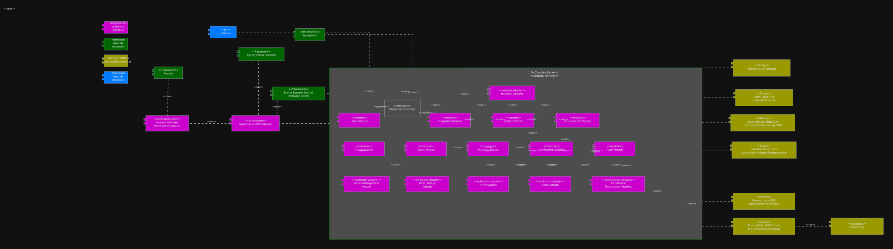
</a>

[Abrir el SVG en tamaño completo](./Diagrams/components-corrected.svg)

## Diagrama de paquetes del backend

Representa el backend Spring Boot como monolito modular con arquitectura hexagonal. Detalla la separación entre dominio, puertos de entrada y salida, servicios de aplicación, adaptadores REST y de persistencia, configuración y eventos de módulos como Users, News, Tasks, Meetings y Notifications.

<a href="./Diagrams/packages-backend.svg">
  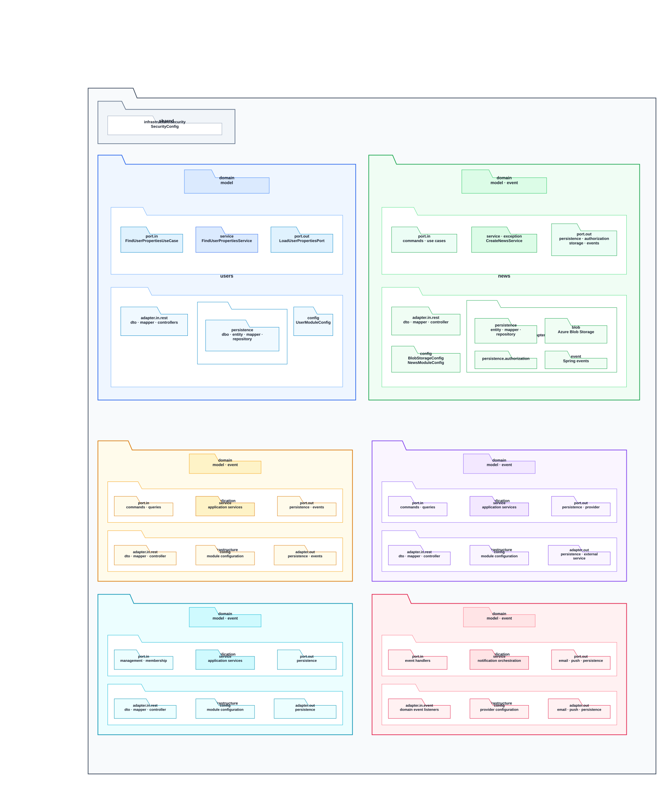
</a>

[Abrir el SVG en tamaño completo](./Diagrams/packages-backend.svg) · [Editar en Draw.io](./Diagrama_de_paquetes.drawio)

## Diagrama de paquetes del API Gateway

Muestra la estructura implementada del API Gateway y sus dependencias principales. Presenta la aplicación Spring Cloud Gateway, el filtro global de Correlation ID y la configuración reactiva de Spring Security que valida y encamina las solicitudes hacia el backend.

<a href="./Diagrams/packages-api-gateway.svg">
  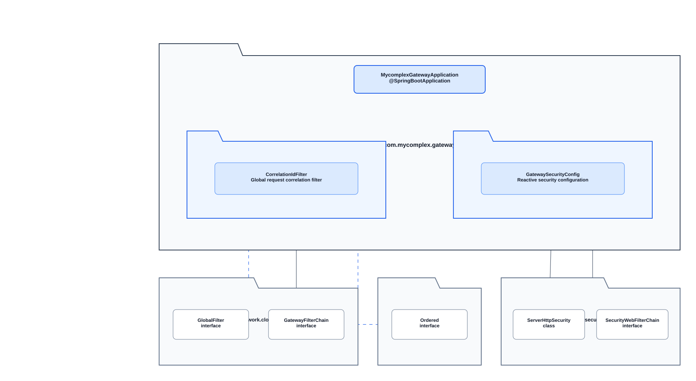
</a>

[Abrir el SVG en tamaño completo](./Diagrams/packages-api-gateway.svg)

## Diagramas de secuencia por módulo

Estas vistas documentan interacciones concretas entre usuarios, aplicaciones, módulos, adaptadores y servicios externos. Describen el comportamiento arquitectónico esperado de cada flujo y complementan las vistas estructurales anteriores.

### Acceso y autorización

Representa el inicio de sesión administrativo con Auth0 y la consulta de copropiedades y roles. Permite seguir el JWT desde el panel web y el API Gateway hasta el backend, el módulo de aplicación y PostgreSQL antes de mostrar las copropiedades disponibles.

<a href="./Diagrams/sequence-access.svg">
  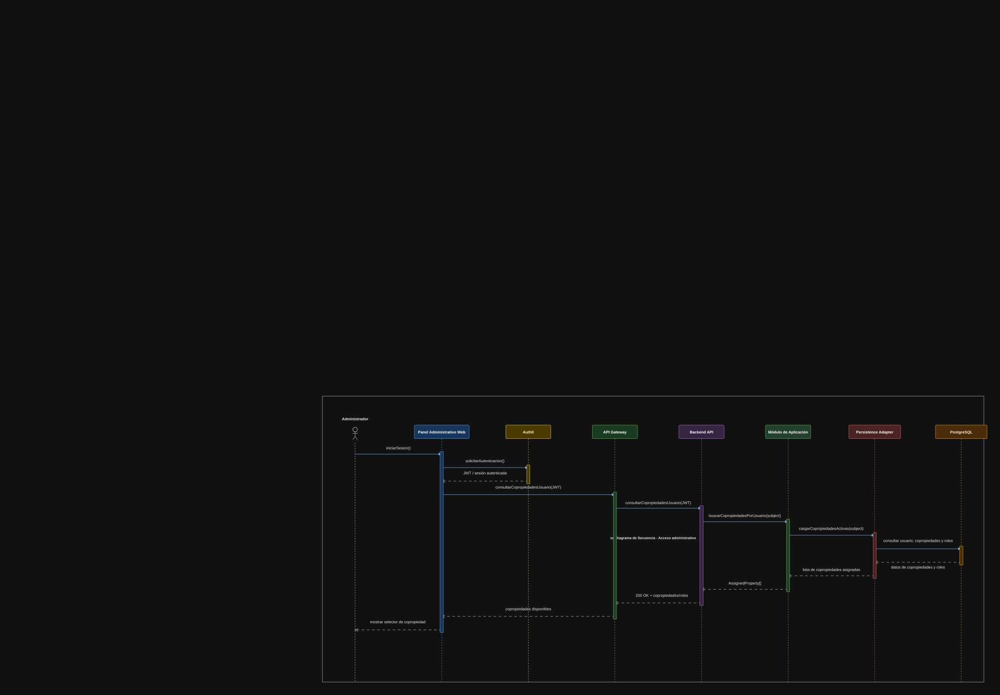
</a>

[Abrir el SVG en tamaño completo](./Diagrams/sequence-access.svg)

### Users Module

Describe la consulta de usuarios de una copropiedad desde el panel administrativo. La secuencia muestra el paso por Gateway y backend, la carga mediante el módulo de aplicación y el adaptador de persistencia, y la respuesta con la lista de usuarios.

<a href="./Diagrams/sequence-users.svg">
  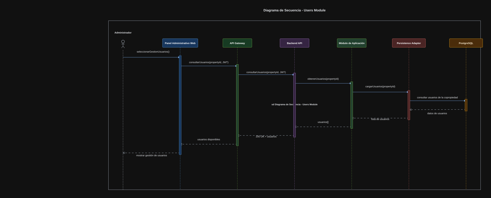
</a>

[Abrir el SVG en tamaño completo](./Diagrams/sequence-users.svg)

### Properties Module

Explica la consulta de estructuras y unidades residenciales asociadas a una copropiedad. Destaca el uso del identificador de copropiedad y del JWT para mantener el alcance de la operación durante el recorrido hasta PostgreSQL.

<a href="./Diagrams/sequence-properties.svg">
  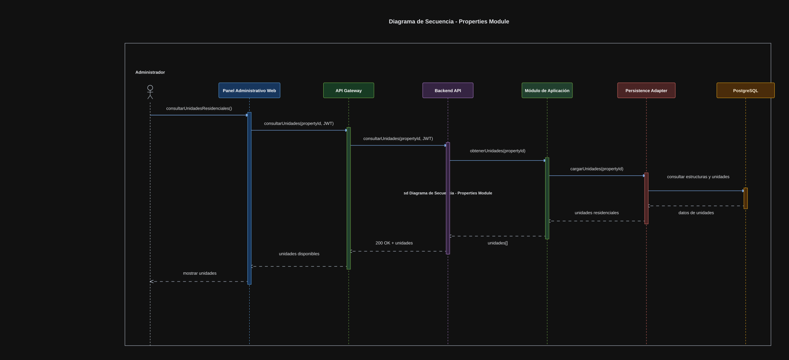
</a>

[Abrir el SVG en tamaño completo](./Diagrams/sequence-properties.svg)

### News Module

Representa la publicación de noticias y el tratamiento opcional de imágenes. Muestra cómo el backend almacena la imagen mediante el adaptador de Blob Storage, conserva su referencia junto con la noticia en PostgreSQL y devuelve la confirmación al panel.

<a href="./Diagrams/sequence-news.svg">
  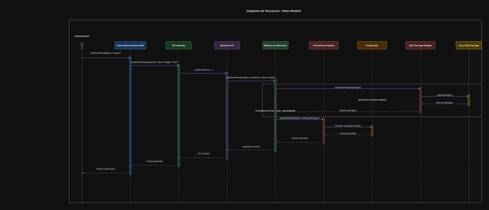
</a>

[Abrir el SVG en tamaño completo](./Diagrams/sequence-news.svg)

### Tasks Module

Documenta la asignación de una tarea a un responsable dentro de una copropiedad. La secuencia permite entender la validación de contexto, la persistencia de la tarea y el retorno de la confirmación a la interfaz administrativa.

<a href="./Diagrams/sequence-tasks.svg">
  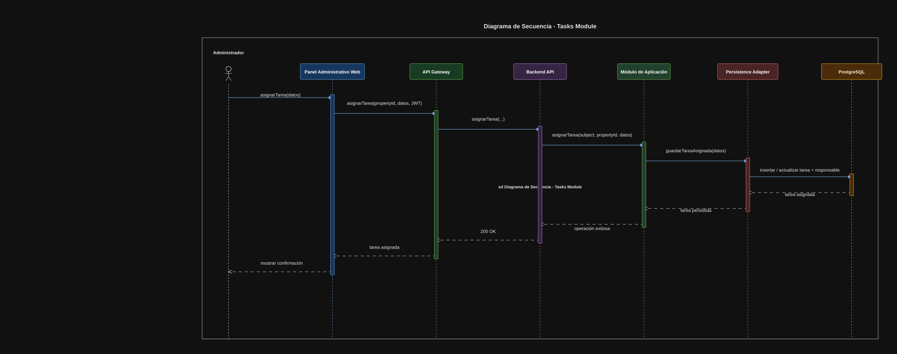
</a>

[Abrir el SVG en tamaño completo](./Diagrams/sequence-tasks.svg)

### Meetings Module

Describe la creación de una reunión desde el panel administrativo. Presenta el recorrido de los datos y el JWT por Gateway, backend, módulo de aplicación y persistencia hasta obtener la reunión creada.

<a href="./Diagrams/sequence-meetings.svg">
  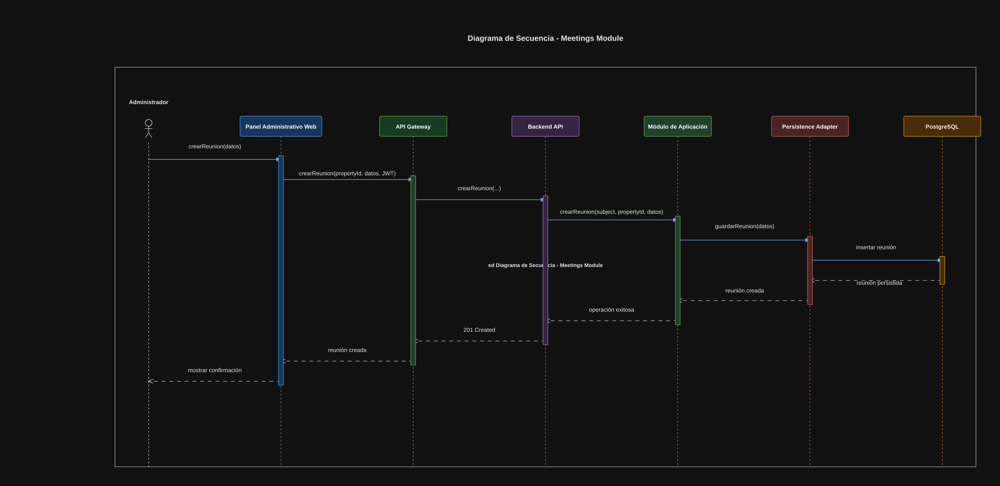
</a>

[Abrir el SVG en tamaño completo](./Diagrams/sequence-meetings.svg)

### Notifications Module

Muestra la orquestación de una notificación originada por otro módulo. Primero registra el evento en PostgreSQL y luego utiliza los adaptadores de Firebase Cloud Messaging y Resend para procesar los canales push y correo transaccional.

<a href="./Diagrams/sequence-notifications.svg">
  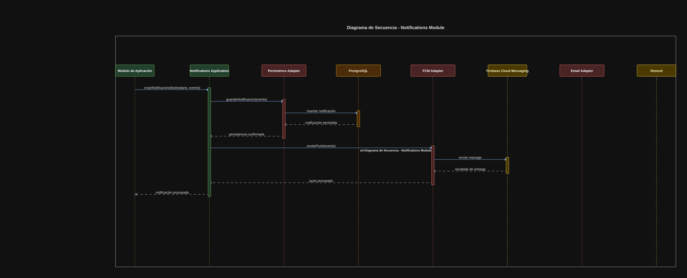
</a>

[Abrir el SVG en tamaño completo](./Diagrams/sequence-notifications.svg)

### Audit Module

Representa el registro de un evento de auditoría generado por un módulo de aplicación. Detalla el envío de actor, acción, recurso y resultado al componente de auditoría y su persistencia posterior en PostgreSQL.

<a href="./Diagrams/sequence-audit.svg">
  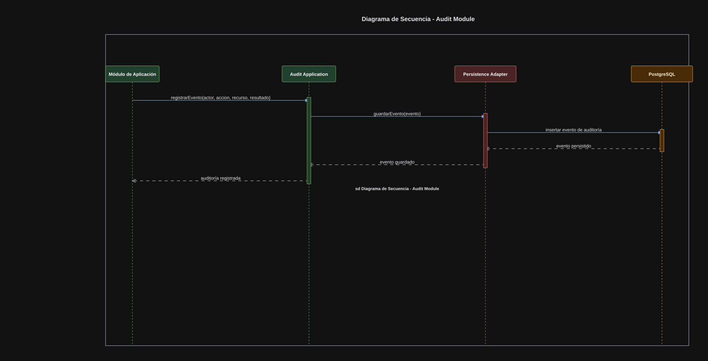
</a>

[Abrir el SVG en tamaño completo](./Diagrams/sequence-audit.svg)
